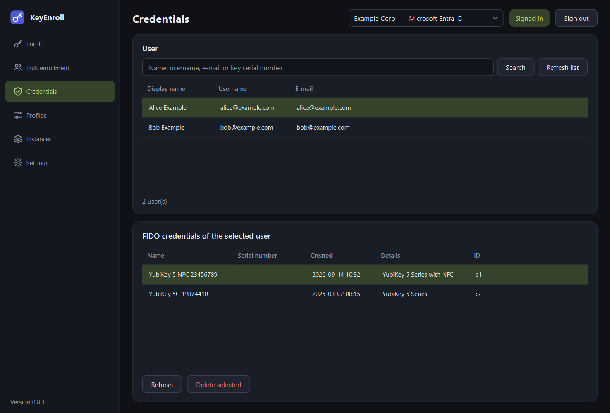

# Credentials

The **Credentials** page shows which FIDO security keys a user has registered at the
identity provider, and lets you delete one — for example when a key is lost or an
employee returns it.

{ .shot }

## The page

**User** (top). When you open the page, it lists **all users** of the directory,
sorted by name, so searching is optional: select a user from the list, or search as
on the [Enroll page](enroll.md#1-user) to narrow it down. **Refresh list** clears
the search and reads the users again; the selected user stays selected. An empty
search lists everyone too. Very large directories show the first 5000 users; search
for the others.

Plugging in a YubiKey shows a highlighted banner at the top of the page saying
[who it belongs to](#key-owner), for example *Connected key S/N 32445513 belongs to:
Alice Example*. **Show the user's keys** selects that user, and the credential on
the plugged-in key is selected, ready to be deleted. The same banner on the
[Enroll page](enroll.md) brings you here.

**FIDO credentials of the selected user** (bottom)

| Column | Meaning |
|---|---|
| **Name** | The name the key was registered under. |
| **Serial number** | With Okta, when the instance [keeps serial numbers](providers.md#key-serial-numbers). Empty otherwise. |
| **Created** | When it was registered. |
| **Details** | What the provider knows about the key, usually its model. |
| **ID** | The provider's identifier of the credential. |

| Button | What it is for |
|---|---|
| **Refresh** | Reads the list again. |
| **Delete selected** | Removes the selected credential from the user's account, after a confirmation. |

!!! danger "Deleting cannot be undone"
    The user can no longer sign in with that key as soon as the credential is
    deleted. To use the key again it has to be enrolled again. Deleting here does
    not touch the key itself: its PIN and its other credentials stay as they are.

## Who a key belongs to { #key-owner }

KeyEnroll reads the serial number of a YubiKey plugged in over USB (keys on an NFC
reader do not report it) and finds its owner, with every identity provider:

1. **Okta** with a [profile attribute for serial numbers](providers.md#key-serial-numbers)
   answers itself.
2. **Entra ID and PingOne** keep the serial number in the key's name, for example
   *YubiKey 23851693* (KeyEnroll with *Add the serial number to the key name*) or
   *Serial: 23851693* (other tools). Neither can search key names across the
   directory, so the first lookup reads the keys of every user, up to 5000, and
   KeyEnroll keeps that list for 15 minutes; enrollments and deletions made in
   KeyEnroll update it at once. This finds keys enrolled from any computer or
   tool. In a large directory the first lookup takes a while.
3. Otherwise the [deployment log](data.md) of this computer says whom the key was
   last enrolled for, and KeyEnroll asks the provider whether that user still has
   it.

| Banner | Meaning |
|---|---|
| *… belongs to: Alice Example* | Confirmed by the identity provider. |
| *According to the deployment log, … belongs to: Alice Example* | Only the log says so: the provider cannot tell the user's keys apart (no serial number in their names), or does not list them (PingOne Advanced Identity Cloud). |
| *… was not found at the identity provider or in the deployment log of this computer* | Entra ID or PingOne: no key name carries this serial number, and this computer did not enroll it. |
| *… is not in the deployment log of this computer* | The key was never enrolled from this computer with this instance, or it was deleted on this page since. |
| *… is not assigned to any user* | Okta with the attribute: nobody has the key. |

A key that the user no longer has (deleted in the admin console, or reset and
enrolled for someone else elsewhere) is not suggested once the provider shows that
all of the user's keys are other ones. A number typed in the user search is looked
up the same way.

## What each provider supports

| Identity provider | List | Delete |
|---|---|---|
| Microsoft Entra ID | yes | yes |
| Okta | yes | yes |
| PingOne PingID | yes | yes |
| PingOne Advanced Identity Cloud | no | no |

PingOne Advanced Identity Cloud does not offer an interface for this; manage the
credentials in its administration console instead. The page says so when such an
instance is selected.
