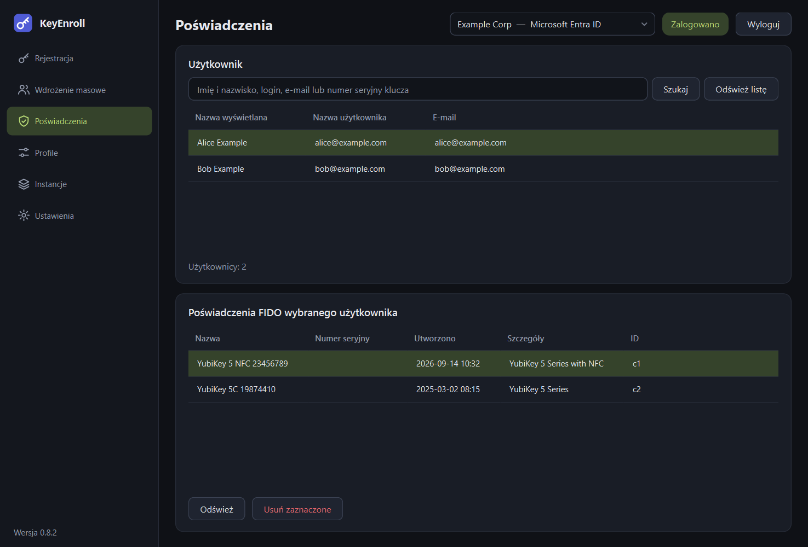

# Poświadczenia

Strona **Poświadczenia** pokazuje, jakie klucze FIDO użytkownik ma zarejestrowane
u dostawcy tożsamości, i pozwala usunąć wybrany — na przykład gdy klucz zaginął albo
pracownik go zwrócił.

{ .shot }

## Strona

**Użytkownik** (u góry). Po otwarciu strony widać **wszystkich użytkowników**
katalogu, posortowanych po nazwie, więc wyszukiwanie jest opcjonalne: zaznacz
użytkownika na liście albo zawęź ją wyszukiwarką, tak jak na
[stronie Rejestracja](enroll.md#1-user). **Odśwież listę** czyści wyszukiwanie
i wczytuje użytkowników ponownie; zaznaczony użytkownik pozostaje zaznaczony. Puste
wyszukiwanie też pokazuje wszystkich. Przy bardzo dużych katalogach widać pierwszych
5000 użytkowników; pozostałych znajdziesz wyszukiwarką.

Po podłączeniu YubiKeya u góry strony pojawia się wyróżniony baner z informacją,
[do kogo klucz należy](#key-owner), np. *Podłączony klucz S/N 32445513 należy do:
Alicja Przykład*. **Pokaż klucze użytkownika** zaznacza tego użytkownika,
a poświadczenie z podłączonego klucza zostaje zaznaczone, gotowe do usunięcia. Ten
sam baner na [stronie Rejestracja](enroll.md) przenosi tutaj.

**Poświadczenia FIDO wybranego użytkownika** (na dole)

| Kolumna | Znaczenie |
|---|---|
| **Nazwa** | Nazwa, pod którą klucz został zarejestrowany. |
| **Numer seryjny** | W Okcie, gdy instancja [zapisuje numery seryjne](providers.md#key-serial-numbers). W pozostałych przypadkach puste. |
| **Utworzono** | Kiedy został zarejestrowany. |
| **Szczegóły** | Co dostawca wie o kluczu, zwykle jego model. |
| **ID** | Identyfikator poświadczenia u dostawcy. |

| Przycisk | Do czego służy |
|---|---|
| **Odśwież** | Odczytuje listę ponownie. |
| **Usuń zaznaczone** | Po potwierdzeniu usuwa zaznaczone poświadczenie z konta użytkownika. |

!!! danger "Usunięcia nie da się cofnąć"
    Po usunięciu poświadczenia użytkownik od razu traci możliwość logowania tym
    kluczem. Żeby znów go używać, klucz trzeba zarejestrować od nowa. Usunięcie
    tutaj nie zmienia niczego na samym kluczu: jego PIN i pozostałe poświadczenia
    zostają.

## Do kogo należy klucz { #key-owner }

KeyEnroll odczytuje numer seryjny YubiKeya podłączonego przez USB (klucze na czytniku
NFC go nie podają) i znajduje właściciela, u każdego dostawcy tożsamości:

1. **Okta** z [atrybutem profilu na numery seryjne](providers.md#key-serial-numbers)
   odpowiada sama.
2. **Entra ID i PingOne** przechowują numer seryjny w nazwie klucza, np. *YubiKey
   23851693* (KeyEnroll z opcją *Dodaj numer seryjny do nazwy klucza*) albo *Serial:
   23851693* (inne narzędzia). Żaden z nich nie wyszukuje nazw kluczy w całym
   katalogu, więc pierwsze sprawdzenie odczytuje klucze wszystkich użytkowników (do
   5000), a KeyEnroll trzyma tę listę przez 15 minut; rejestracje i usunięcia
   zrobione w KeyEnroll aktualizują ją od razu. Tak znajdują się klucze
   zarejestrowane z dowolnego komputera i dowolnym narzędziem. W dużym katalogu
   pierwsze sprawdzenie trwa dłuższą chwilę.
3. W pozostałych przypadkach [dziennik wdrożeń](data.md) tego komputera mówi, dla
   kogo klucz zarejestrowano ostatnio, a KeyEnroll pyta dostawcę, czy ten
   użytkownik nadal go ma.

| Baner | Znaczenie |
|---|---|
| *… należy do: Alicja Przykład* | Potwierdzone przez dostawcę tożsamości. |
| *Według dziennika wdrożeń … należy do: Alicja Przykład* | Mówi tak tylko dziennik: dostawca nie odróżnia kluczy użytkownika (brak numeru w nazwach) albo ich nie udostępnia (PingOne Advanced Identity Cloud). |
| *… nie znaleziono u dostawcy tożsamości ani w dzienniku wdrożeń tego komputera* | Entra ID lub PingOne: żadna nazwa klucza nie zawiera tego numeru, a ten komputer go nie rejestrował. |
| *… nie ma w dzienniku wdrożeń tego komputera* | Klucza nigdy nie rejestrowano z tego komputera w tej instancji albo usunięto go od tego czasu na tej stronie. |
| *… nie jest przypisany do żadnego użytkownika* | Okta z atrybutem: nikt nie ma tego klucza. |

Klucz, którego użytkownik już nie ma (usunięty w konsoli albo zresetowany
i zarejestrowany gdzie indziej dla kogoś innego), nie jest podpowiadany, gdy dostawca
pokazuje, że wszystkie klucze użytkownika są inne. Liczba wpisana w wyszukiwarkę
użytkowników jest sprawdzana tak samo.

## Co obsługują dostawcy

| Dostawca tożsamości | Lista | Usuwanie |
|---|---|---|
| Microsoft Entra ID | tak | tak |
| Okta | tak | tak |
| PingOne PingID | tak | tak |
| PingOne Advanced Identity Cloud | nie | nie |

PingOne Advanced Identity Cloud nie udostępnia do tego interfejsu; poświadczeniami
zarządza się w jego konsoli administracyjnej. Strona informuje o tym, gdy wybrana
jest taka instancja.
