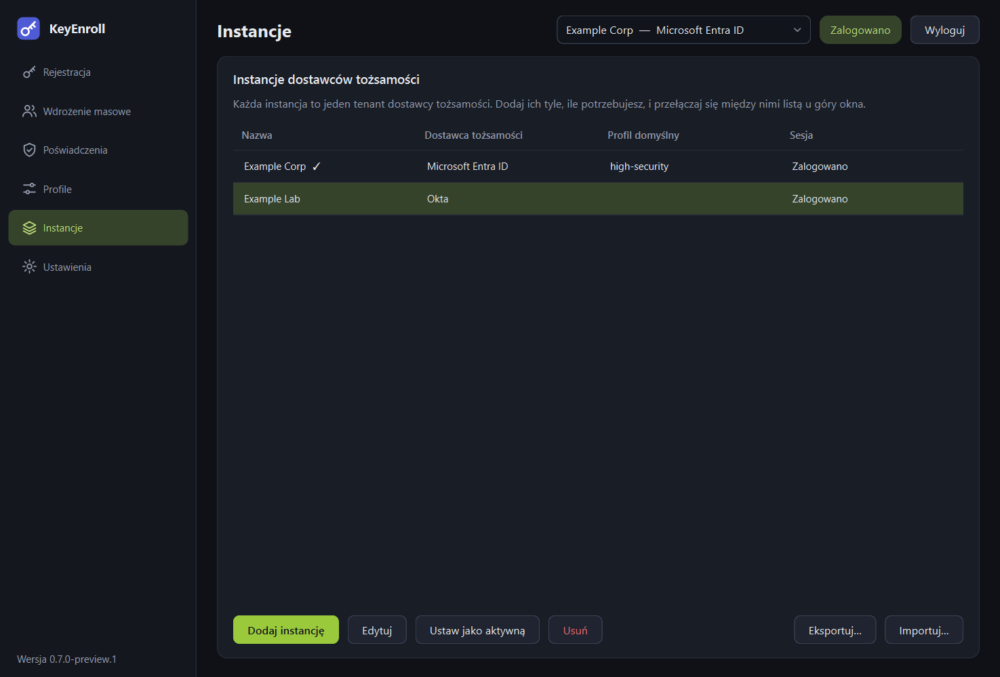
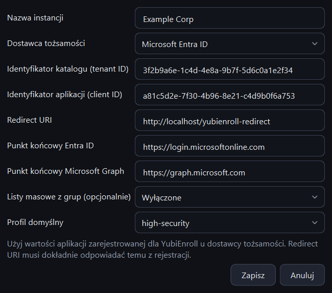

# Instancje i logowanie

**Instancja** to jeden tenant dostawcy tożsamości razem z ustawieniami, których
KeyEnroll potrzebuje, żeby się z nim połączyć. Możesz mieć ich dowolnie wiele —
tenanty produkcyjne i testowe, kilku klientów, różnych dostawców — i przełączać się
między nimi bez wychodzenia z aplikacji.

{ .shot }

## Strona

| Kolumna | Znaczenie |
|---|---|
| **Nazwa** | Nazwa nadana instancji. Aktywna jest oznaczona znakiem ✓. |
| **Dostawca tożsamości** | Entra ID, Okta, PingOne PingID lub PingOne Advanced Identity Cloud. |
| **Profil domyślny** | [Profil](profiles.md) wybierany, gdy ta instancja jest aktywna. |
| **Sesja** | Czy dla tej instancji jest zapisane logowanie. |

| Przycisk | Do czego służy |
|---|---|
| **Dodaj instancję** | Otwiera formularz nowej instancji. |
| **Edytuj** | Zmienia zaznaczoną instancję. To samo robi dwukrotne kliknięcie wiersza. Dostawcy tożsamości istniejącej instancji nie można zmienić. |
| **Ustaw jako aktywną** | Czyni zaznaczoną instancję tą, z którą pracujesz. To samo robi lista u góry okna. |
| **Usuń** | Usuwa z tego komputera instancję **wraz z zapisanym logowaniem**. U dostawcy tożsamości nic się nie zmienia. |
| **Eksportuj…**, **Importuj…** | Przenoszą instancje i profile na inny komputer, zob. [niżej](#moving-the-configuration). |

## Dodawanie instancji

{ .shot .dialog }

| Pole | Co wpisać |
|---|---|
| **Nazwa instancji** | Dowolna nazwa, po której rozpoznasz tenant, np. *Produkcja*. |
| **Dostawca tożsamości** | Rodzaj tenanta. Od niego zależą pola poniżej. |
| Pola dostawcy | Wartości aplikacji zarejestrowanej u dostawcy tożsamości. Każde pole opisuje strona [Dostawcy tożsamości](providers.md). |
| **Profil domyślny** | Opcjonalny. |

!!! warning "Redirect URI musi zgadzać się co do znaku"
    Redirect URI musi być dokładnie taki sam jak wpisany w rejestracji aplikacji
    u dostawcy tożsamości — u Okta i Ping łącznie z numerem portu. Zawsze zaczyna
    się od `http://localhost`. Niezgodność to najczęstsza przyczyna nieudanego
    logowania.

## Przenoszenie konfiguracji { #moving-the-configuration }

!!! info "Od wersji 0.6.0"

Kilku administratorów albo nowe stanowisko może pracować z tymi samymi instancjami
i profilami bez wpisywania ich od nowa.

1. Na komputerze, na którym są: **Eksportuj…**, wybierz, co zapisać (instancje,
   profile, [wiadomość dla użytkownika](settings.md#message-for-the-user)), i zapisz
   plik `.json`.
2. Na drugim komputerze: **Importuj…** i wskaż plik. Wybierz, co przejąć i co zrobić
   z **nazwami, które już istnieją**:

    | Wybór | Skutek |
    |---|---|
    | **Dodaj je pod nową nazwą** (domyślnie) | Importowany wpis zostaje dodany np. jako *Produkcja (2)*. Nic istniejącego się nie zmienia. |
    | **Zastąp istniejące** | Istniejąca instancja lub profil przejmuje zaimportowane ustawienia. Instancja zachowuje logowanie, chyba że zmienił się jej dostawca tożsamości. |
    | **Zostaw istniejące** | Importowany wpis zostaje pominięty. |

3. **Zaloguj się** do każdej zaimportowanej instancji. Plik nie zawiera logowań ani
   sekretów, tylko wartości wpisane w formularzu instancji, więc nie trzeba go
   traktować jak hasła. Zawiera jednak nazwy Twoich tenantów: przekazuj go zaufanym
   kanałem.

Wpisy, których aplikacja nie może użyć, np. instancja dostawcy nieznanego tej wersji,
są wymienione w oknie importu i pomijane. Plik z nowszej wersji KeyEnroll jest
odrzucany; najpierw zaktualizuj aplikację.

## Przełączanie instancji

Użyj listy u góry okna. Wyszukiwanie, rejestracje i lista poświadczeń zawsze
dotyczą instancji tam widocznej. W trakcie rejestracji lista jest zablokowana.

Każda instancja ma własne logowanie, więc przełączenie nigdzie Cię nie wylogowuje.

## Logowanie { #signing-in }

Kliknij **Zaloguj** na górnym pasku.

1. W domyślnej przeglądarce otworzy się strona logowania dostawcy tożsamości.
2. Zaloguj się tam kontem administratora, z uwierzytelnianiem wieloskładnikowym,
   jeśli Twoja organizacja go wymaga.
3. Przeglądarka pokaże krótkie potwierdzenie i można wrócić do KeyEnroll. Znacznik
   na górnym pasku zmieni się na **Zalogowano**.

KeyEnroll nigdy nie widzi Twojego hasła: logowanie odbywa się w całości
w przeglądarce, a aplikacja dostaje od dostawcy tożsamości jedynie token.

**Logowanie jest zapamiętywane.** Trafia do systemowego magazynu poświadczeń
(Menedżer poświadczeń Windows, Pęk kluczy macOS albo Secret Service w Linuksie),
nigdy do pliku ustawień. O tym, jak długo jest ważne, decyduje dostawca tożsamości;
gdy wygaśnie, aplikacja poprosi o ponowne zalogowanie.

**Wyloguj** kończy sesję i usuwa zapisane logowanie z tego komputera.

### Co musi móc konto

Zalogowany administrator musi mieć prawo odczytywać użytkowników i zarządzać ich
metodami uwierzytelniania. Konkretna rola zależy od dostawcy, patrz
[Dostawcy tożsamości](providers.md). Brak uprawnienia objawia się błędem dostawcy
przy wyszukiwaniu użytkownika albo na początku rejestracji.
