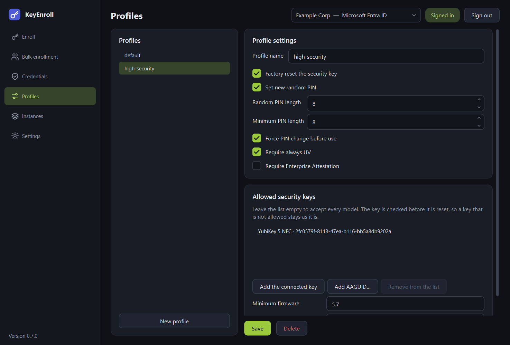
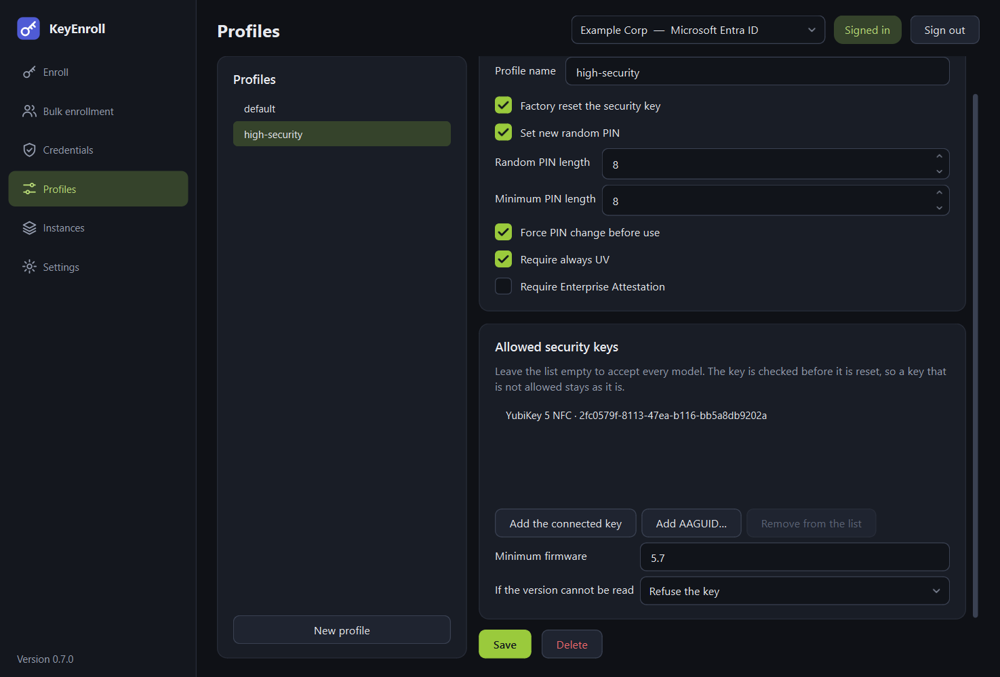

# Profiles

A profile is a named set of enrollment options. Instead of ticking the same boxes
for every key, you choose a profile on the [Enroll](enroll.md) or
[Bulk enrollment](bulk.md) page.

{ .shot }

## The page

| Control | What it is for |
|---|---|
| List on the left | The stored profiles. Select one to see and edit it. |
| **New profile** | Starts an empty profile with the default options. |
| **Profile name** | The name shown in the profile selectors. |
| **Save** | Stores the changes. |
| **Delete** | Removes the selected profile. |

A profile called `default` exists from the start. An [instance](instances.md) can
name a default profile, which is then preselected whenever that instance is active.

## The options

### Factory reset the security key

Erases **all FIDO credentials and the PIN** on the key before enrolling it.

- **On** (default): recommended for new keys and for keys that are reassigned. It
  guarantees a known starting point.
- **Off**: the existing credentials and PIN are kept. You are asked for the current
  PIN during enrollment. Use this to add your organisation's credential to a key the
  user already uses elsewhere.

A reset must be confirmed within a few seconds of plugging the key in, which is why
the application asks you to remove and re-insert it. Only the FIDO part of the key
is reset; other functions of a YubiKey (OTP, PIV, OpenPGP) are not affected.

### Set new random PIN

- **On** (default): KeyEnroll generates a numeric PIN and shows it when the
  enrollment is done.
- **Off**: you type the PIN yourself, or the key's existing PIN is kept.

Random PINs consist of digits, never start with a zero, and avoid trivial patterns
such as `111111` or `123456` that keys with PIN complexity rules would refuse.

### Random PIN length

The number of digits of the generated PIN, 4 to 63 (default 6). It cannot be shorter
than the minimum PIN length.

### Minimum PIN length

The shortest PIN the key will accept **from now on**, 4 to 63 (default 4). The user
cannot later choose a shorter PIN. A key never allows this value to be lowered again
without a factory reset.

### Force PIN change before use

The user has to replace the temporary PIN with one of their own the first time they
use the key. Combine it with a random PIN so that the administrator never knows the
user's final PIN.

### Require always UV

"Always require user verification": the key asks for the PIN **on every use**, even
when a website would not insist on it.

### Require Enterprise Attestation

Lets the key identify itself — including its serial number — to an identity provider
that requests *enterprise attestation*. This only works with keys that were ordered
with that feature and with a provider configured for it. Leave it off unless you
know you need it.

## Allowed security keys

!!! info "Since version 0.6.0"

A profile can accept only certain key models, for example only the YubiKeys your
organisation buys. The key is checked **before it is reset**: a key that is not
allowed is left exactly as it was, with its credentials and PIN.

{ .shot }

| Control | What it is for |
|---|---|
| List of models | The models the profile accepts, each identified by its *AAGUID* (a model number every FIDO2 key reports) and a name of your choice. **An empty list accepts every model.** Double-click an entry to rename it. |
| **Add the connected key** | Reads the model of the security key that is plugged in and adds it. The quickest way: plug in one key of each model you hand out. |
| **Add AAGUID…** | Enter an AAGUID by hand, for example from the vendor's documentation. |
| **Remove** | Takes the selected models off the list. |
| **Minimum firmware** | For example `5.7`. Keys with older firmware are refused. Empty: no requirement. |
| **If the version cannot be read** | The firmware version is read from YubiKeys over USB only; keys from other vendors and keys on an NFC reader do not report it. **Refuse the key** (default) stops the enrollment; **Only warn** enrolls the key and records a warning. |

On the [Enroll page](enroll.md) the status line of the key already shows when the
selected key does not match the profile, and the enrollment does not start. In
[bulk enrollment](bulk.md) the batch stops at that key, and a warning appears in the
*Message* column.

!!! tip "Also set the policy at the identity provider"
    This check protects the key from being reset for nothing. Which keys may sign in
    is still decided by the identity provider: in Entra ID, for example, by the AAGUID
    restriction of the passkey policy.

## What the key has to support

| Option | Requirement |
|---|---|
| Factory reset, PIN | Any FIDO2 key. |
| Minimum PIN length, forced PIN change, always UV | A key whose firmware offers authenticator configuration (YubiKey firmware 5.5 or newer). |
| Enterprise Attestation | A key manufactured with Enterprise Attestation. |

The application checks the key **before** it changes anything. If the key cannot do
what the profile asks, the enrollment stops with a message and the key is left
untouched.

## Examples

| Goal | Reset | Random PIN | PIN length | Minimum | Force change | Always UV |
|---|---|---|---|---|---|---|
| New keys handed out by IT | on | on | 6 | 6 | on | off |
| High-security accounts | on | on | 8 | 8 | on | on |
| Add a credential to the user's own key | off | off | — | 4 | off | off |
